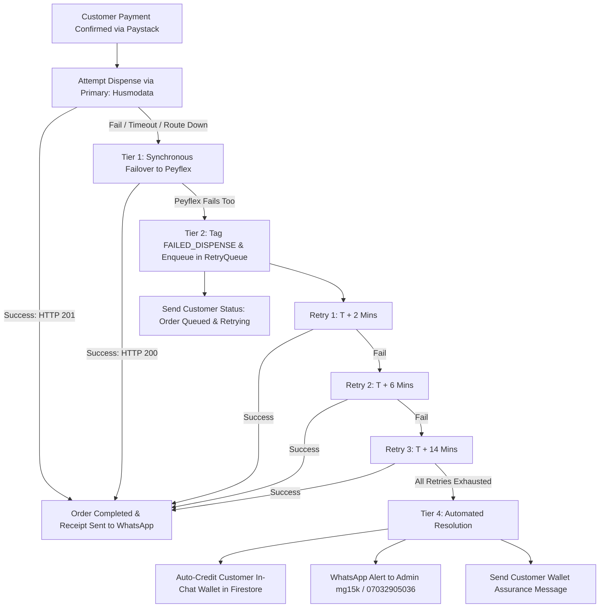

# 📡 Clarion A.I. Telecom Architecture: Catalog, Network-Filtered Flow & Failure Recovery Specification

*Generated on: 2026-11-06*  
*Scope: Clean Catalog (MTN, Glo, Airtel), Intelligent Network Detection UX, 2-Step Confirmation Flow, and Multi-Tier Payment Failure Recovery Engine.*
*Generated on: 2026-11-06 · Last Updated: 2026-11-07*  
*Scope: Clean Catalog (MTN, Glo, Airtel), Intelligent Network Detection UX, Cross-Network Browse Flow, 2-Step Recipient Confirmation with Network Validation, and Multi-Tier Payment Failure Recovery Engine.*  
*Payment Gateway: **Paystack** (Dynamic Dedicated Virtual Accounts). Data Providers: **Husmodata** (primary) + **Peyflex** (failover).*

---

## 📑 Table of Contents
1. [Master Approved Data Catalog (Clean Names & Financials)](#1-master-approved-data-catalog)
   - [MTN Data Catalog (17 Plans)](#mtn-data-catalog-17-plans)
   - [Glo Data Catalog (12 Plans)](#glo-data-catalog-12-plans)
   - [Airtel Data Catalog (11 Plans)](#airtel-data-catalog-11-plans)
   - [Catalog Summary (40 Plans Total)](#catalog-summary)
2. [Intelligent Network-Filtered Chat UX](#2-intelligent-network-filtered-chat-ux)
   - [Automatic Phone Prefix Detection Logic](#automatic-phone-prefix-detection-logic)
   - [Standard `DATA` Command Response](#standard-data-command-response)
   - [Cross-Network Browse Flow (Post-Plan-List)](#cross-network-browse-flow)
   - [Two-Step Recipient Phone & WhatsApp Contact Card Flow](#two-step-recipient-phone--whatsapp-contact-card-flow)
   - [Interactive Order Confirmation & Invoice Generation](#interactive-order-confirmation--invoice-generation)
   - [Wrong-Network Phone Validation & Warning Gate](#wrong-network-phone-validation)
   - [Interactive Order Confirmation & Paystack Invoice](#interactive-order-confirmation--invoice-generation)
3. [Budget-Filtered Responses (`DATA 2000`) for Airtel, MTN & Glo](#3-budget-filtered-responses-data-2000)
   - [Airtel Line Response for `DATA 2000`](#airtel-response-data-2000)
   - [MTN Line Response for `DATA 2000`](#mtn-response-data-2000)
   - [Glo Line Response for `DATA 2000`](#glo-response-data-2000)
4. [Multi-Tier Failure Recovery & Retry Architecture](#4-multi-tier-failure-recovery--retry-architecture)
   - [Downstream Failure Root Causes](#failure-scenarios)
   - [Resilience Flow Diagram](#resilience-flowchart)
   - [Tier 1: Synchronous Dual-Provider Failover (0–3 Seconds)](#tier-1-synchronous-dual-provider-failover)
   - [Tier 2: Asynchronous Exponential Backoff Retry Queue](#tier-2-asynchronous-exponential-backoff-retry-queue)
   - [Tier 3: Circuit Breaker & Provider Health Isolation](#tier-3-circuit-breaker--provider-health-isolation)
   - [Tier 4: Automated In-Chat Wallet Credit & Admin Alert (No Cash Refunds)](#tier-4-automated-customer-wallet-credit--admin-alert)
5. [Step-by-Step Implementation Roadmap (No Code Yet)](#5-step-by-step-implementation-roadmap)

---

<a name="1-master-approved-data-catalog"></a>
## 1. Master Approved Data Catalog (Clean Names & Financials)

> **Naming Rule Compliance:**  
> All telecom aggregator jargon (such as *SME*, *Data Share*, *Corporate Gifting*, *Awoof*) has been completely stripped out. All customer-facing labels follow clean, professional formatting (e.g., `1GB (30 Days)`, `4GB (2 Days Binge)`, `3.2GB (2 Days)`).

> **Paystack Fee Calculation:**  
> * Under ₦2,500: $\text{Fee} = \text{round}(\text{Sell} \times 0.015)$  
> * ₦2,500 & Above: $\text{Fee} = \min(2000, \text{round}(\text{Sell} \times 0.015 + 100))$

---

### MTN Data Catalog (17 Plans)
Primary Provider: **Husmodata** (cheaper on micro gems & daily bundles; direct gifting verified). Failover: **Peyflex**.

| # | Plan Code | Clean Customer Label | Validity / Duration | Primary Provider & ID | Wholesale Cost (₦) | Sell Price (₦) | Paystack Fee (₦) | Net Profit (₦) | Margin |
| :-: | :--- | :--- | :---: | :--- | --: | --: | --: | --: | :---: |
| 1 | `M110MBS` | **110MB** | 1 Day | Husmodata (`ID 403`) | ₦98 | ₦100 | ₦2 | **₦0** | 0.0% *(Hook)* |
| 2 | `M1GB1D` | **1GB** | 1 Day | Husmodata (`ID 495`) | ₦260 | ₦400 | ₦6 | **+₦134** | 33.5% |
| 3 | `M3m2GB2D` | **3.2GB** | 2 Days | Husmodata (`ID 378`) | ₦970 | ₦1,000 | ₦15 | **+₦15** | 1.5% |
| 4 | `M7GB2D` | **7GB** | 2 Days | Husmodata (`ID 478`) | ₦1,745 | ₦1,800 | ₦27 | **+₦28** | 1.6% |
| 5 | `M500MBS` | **500MB** | 7 Days | Husmodata (`ID 458`) | ₦300 | ₦500 | ₦8 | **+₦192** | 38.4% |
| 6 | `M1GBS` | **1GB** | 7 Days | Husmodata (`ID 466`) | ₦380 | ₦600 | ₦9 | **+₦211** | 35.2% |
| 7 | `M2GBS` | **2GB** | 7 Days | Husmodata (`ID 467`) | ₦735 | ₦1,200 | ₦18 | **+₦447** | 37.3% |
| 8 | `M3GBS` | **3GB** | 7 Days | Husmodata (`ID 468`) | ₦1,075 | ₦1,400 | ₦21 | **+₦304** | 21.7% |
| 9 | `M1GBS2` | **1GB** | 30 Days | Husmodata (`ID 457`) | ₦392 | ₦850 | ₦13 | **+₦445** | 52.4% |
| 10 | `M2GBS2` | **2GB** | 30 Days | Husmodata (`ID 459`) | ₦805 | ₦1,700 | ₦26 | **+₦869** | 51.1% |
| 11 | `M3GBS2` | **3GB** | 30 Days | Husmodata (`ID 460`) | ₦1,125 | ₦2,000 | ₦30 | **+₦845** | 42.3% |
| 12 | `M5GBS` | **5GB** | 30 Days | Husmodata (`ID 309`) | ₦1,610 | ₦2,500 | ₦138 | **+₦752** | 30.1% |
| 13 | `M7GBS` | **7GB** | 30 Days | Peyflex (`M7GBS`) | ₦3,450 | ₦3,700 | ₦156 | **+₦94** | 2.5% |
| 14 | `M14m5GBS`| **14.5GB** | 30 Days | Husmodata (`ID 399`) | ₦4,850 | ₦5,200 | ₦178 | **+₦172** | 3.3% |
| 15 | `M20GBS` | **20GB** | 30 Days | Husmodata (`ID 424`) | ₦7,260 | ₦7,500 | ₦213 | **+₦27** | 0.4% |
| 16 | `M25GBS` | **25GB** | 30 Days | Husmodata (`ID 423`) | ₦8,700 | ₦9,000 | ₦235 | **+₦65** | 0.7% |
| 17 | `M36GBS` | **36GB** | 30 Days | Husmodata (`ID 379`) | ₦10,670 | ₦11,000 | ₦265 | **+₦65** | 0.6% |

---

### Glo Data Catalog (12 Plans)
Primary Provider: **Husmodata** for monthly & micro bundles; **Peyflex** for multi-GB 3-day and 7-day plans.

| # | Plan Code | Clean Customer Label | Validity / Duration | Primary Provider & ID | Wholesale Cost (₦) | Sell Price (₦) | Paystack Fee (₦) | Net Profit (₦) | Margin |
| :-: | :--- | :--- | :---: | :--- | --: | --: | --: | --: | :---: |
| 1 | `G2m5GB` | **2.5GB** | 2 Days | Husmodata (`ID 323`) | ₦475 | ₦690 | ₦10 | **+₦205** | 29.7% |
| 2 | `G1GB1` | **1GB** | 3 Days | Husmo (`479`) / Peyflex | ₦335 | ₦400 | ₦6 | **+₦59** | 14.8% |
| 3 | `G3GB1` | **3GB** | 3 Days | Peyflex (`G3GB1`) | ₦850 | ₦1,200 | ₦18 | **+₦332** | 27.7% |
| 4 | `G5GB1` | **5GB** | 3 Days | Peyflex (`G5GB1`) | ₦1,380 | ₦2,000 | ₦30 | **+₦590** | 29.5% |
| 5 | `G1GB2` | **1GB** | 7 Days | Husmodata (`ID 447`) | ₦349 | ₦400 | ₦6 | **+₦45** | 11.3% |
| 6 | `G3GB2` | **3GB** | 7 Days | Peyflex (`G3GB2`) | ₦990 | ₦1,200 | ₦18 | **+₦192** | 16.0% |
| 7 | `G5GB2` | **5GB** | 7 Days | Peyflex (`G5GB2`) | ₦1,580 | ₦2,000 | ₦30 | **+₦390** | 19.5% |
| 8 | `G500MB` | **500MB** | 30 Days | Husmodata (`ID 258`) | ₦200 | ₦250 | ₦4 | **+₦46** | 18.4% |
| 9 | `G1GB4` | **1GB** | 30 Days | Husmodata (`ID 261`) | ₦400 | ₦460 | ₦7 | **+₦53** | 11.5% |
| 10 | `G2GB4` | **2GB** | 30 Days | Husmodata (`ID 262`) | ₦800 | ₦900 | ₦14 | **+₦86** | 9.6% |
| 11 | `G3GB4` | **3GB** | 30 Days | Husmodata (`ID 263`) | ₦1,200 | ₦1,500 | ₦23 | **+₦277** | 18.5% |
| 12 | `G5GB4` | **5GB** | 30 Days | Husmodata (`ID 297`) | ₦2,000 | ₦2,400 | ₦36 | **+₦364** | 15.2% |

---

### Airtel Data Catalog (11 Plans)
Primary Provider: **Husmodata**. Failover: **Peyflex**.

| # | Plan Code | Clean Customer Label | Validity / Duration | Primary Provider & ID | Wholesale Cost (₦) | Sell Price (₦) | Paystack Fee (₦) | Net Profit (₦) | Margin |
| :-: | :--- | :--- | :---: | :--- | --: | --: | --: | --: | :---: |
| 1 | `A300MB` | **300MB** | 2 Days | Husmodata (`ID 450`) | ₦112 | ₦400 | ₦6 | **+₦282** | 70.5% |
| 2 | `A600MB` | **600MB** | 2 Days | Husmodata (`ID 451`) | ₦213 | ₦400 | ₦6 | **+₦181** | 45.3% |
| 3 | `A4GB` | **4GB (Binge)** | 2 Days | Husmodata (`ID 407`) | ₦975 | ₦1,000 | ₦15 | **+₦10** | 1.0% |
| 4 | `A6GB` | **6GB (Binge)** | 2 Days | Husmodata (`ID 498`) | ₦1,440 | ₦1,500 | ₦23 | **+₦37** | 2.5% |
| 5 | `A1GB` | **1GB** | 7 Days | Husmodata (`ID 125`) | ₦780 | ₦800 | ₦12 | **+₦8** | 1.0% |
| 6 | `A20GB` | **20GB** | 7 Days | Husmodata (`ID 137`) | ₦4,800 | ₦5,000 | ₦175 | **+₦25** | 0.5% |
| 7 | `A2GB` | **2GB** | 30 Days | Husmodata (`ID 406`) | ₦1,463 | ₦1,500 | ₦23 | **+₦14** | 0.9% |
| 8 | `A3GB` | **3GB** | 30 Days | Husmodata (`ID 133`) | ₦1,950 | ₦2,000 | ₦30 | **+₦20** | 1.0% |
| 9 | `A10GB` | **10GB** | 30 Days | Husmodata (`ID 318`) | ₦3,020 | ₦3,900 | ₦159 | **+₦721** | 18.5% |
| 10 | `A25GB` | **25GB** | 30 Days | Husmodata (`ID 139`) | ₦7,800 | **₦8,200** | ₦223 | **+₦177** | 2.2% |
| 11 | `A100GB` | **100GB** | 30 Days | Husmodata (`ID 141`) | ₦19,500 | ₦20,000 | ₦400 | **+₦100** | 0.5% |

*(Note: `A25GB` is set to ₦8,200 to guarantee a healthy +₦177 profit after Paystack fee).*

---

### Catalog Summary
* **MTN Active Plans**: 17
* **Glo Active Plans**: 12
* **Airtel Active Plans**: 11
* **TOTAL ACTIVE APPROVED CATALOG**: **40 Plans**

---

<a name="2-intelligent-network-filtered-chat-ux"></a>
## 2. Intelligent Network-Filtered Chat UX

### Automatic Phone Prefix Detection Logic
When a customer sends any keyword (`DATA`, `DATA 2000`, `DATA + PRICE`), ProxyBot extracts their sender phone number from their WhatsApp JID:
```javascript
const cleanPhone = from.split('@')[0].replace(/\D/g, '');
// e.g. "2348021234567" -> normalized to "08021234567"
const prefix = normalized.substring(0, 4);
```
* **MTN Prefixes**: `0803`, `0806`, `0810`, `0813`, `0814`, `0816`, `0703`, `0706`, `0903`, `0906`, `0913`, `0916`
* **Glo Prefixes**: `0805`, `0807`, `0811`, `0815`, `0705`, `0905`, `0915`
* **Airtel Prefixes**: `0802`, `0808`, `0812`, `0701`, `0708`, `0901`, `0902`, `0904`, `0907`, `0912`
* **9mobile Prefixes**: `0809`, `0817`, `0818`, `0908`, `0909`

---

### Standard `DATA` Command Response Flow
If an Airtel customer texts `DATA`, ProxyBot replies **strictly with Airtel plans**:

```
📶 AIRTEL DATA PACKAGES ⚡
━━━━━━━━━━━━━━Line detected: 0802•••••36 (Airtel)

⚡ 2-Day Plans:
• 300MB (2 Days) — ₦400 ➔ Reply BUY A300MB
• 600MB (2 Days) — ₦400 ➔ Reply BUY A600MB
• 4GB (2 Days Binge) — ₦1,000 ➔ Reply BUY A4GB
• 6GB (2 Days Binge) — ₦1,500 ➔ Reply BUY A6GB

📅 7-Day Plans:
• 1GB (7 Days) — ₦800 ➔ Reply BUY A1GB
• 20GB (7 Days) — ₦5,000 ➔ Reply BUY A20GB

🗓️ 30-Day Monthly Plans:
• 2GB (30 Days) — ₦1,500 ➔ Reply BUY A2GB
• 3GB (30 Days) — ₦2,000 ➔ Reply BUY A3GB
• 10GB (30 Days) — ₦3,900 ➔ Reply BUY A10GB
• 25GB (30 Days) — ₦8,200 ➔ Reply BUY A25GB
• 100GB (30 Days) — ₦20,000 ➔ Reply BUY A100GB

━━━━━━━━━━━━━━🔄 Not buying for this Airtel line?
Reply MTN or GLO to browse other networks.
👉 Reply BUY [code] (e.g. BUY A10GB) to begin order.
```

---

<a name="cross-network-browse-flow"></a>
### Cross-Network Browse Flow (Post-Plan-List)
If the customer wants to buy data for someone on a different network, they reply `GLO` or `MTN`.  
The bot shows that network's menu, noting that recipient phone confirmation happens right after plan selection:

```
📶 GLO DATA PACKAGES ⚡
━━━━━━━━━━━━━━Browsing network: Glo

⚡ 2-Day & 3-Day Plans:
• 2.5GB (2 Days) — ₦690 ➔ Reply BUY G2m5GB
• 1GB (3 Days) — ₦400 ➔ Reply BUY G1GB1
• 3GB (3 Days) — ₦1,200 ➔ Reply BUY G3GB1
• 5GB (3 Days) — ₦2,000 ➔ Reply BUY G5GB1

📅 7-Day Plans:
• 1GB (7 Days) — ₦400 ➔ Reply BUY G1GB2
• 3GB (7 Days) — ₦1,200 ➔ Reply BUY G3GB2
• 5GB (7 Days) — ₦2,000 ➔ Reply BUY G5GB2

🗓️ 30-Day Monthly Plans:
• 500MB (30 Days) — ₦250 ➔ Reply BUY G500MB
• 1GB (30 Days) — ₦460 ➔ Reply BUY G1GB4
• 2GB (30 Days) — ₦900 ➔ Reply BUY G2GB4
• 3GB (30 Days) — ₦1,500 ➔ Reply BUY G3GB4
• 5GB (30 Days) — ₦2,400 ➔ Reply BUY G5GB4

━━━━━━━━━━━━━━👉 Reply BUY [code] (e.g. BUY G2m5GB).
You will enter the recipient phone number in the next step!
```

---

<a name="two-step-recipient-phone--whatsapp-contact-card-flow"></a>
### Two-Step Recipient Phone & WhatsApp Contact Card Flow

When the customer replies `BUY A10GB` (or any buy code):

#### Step 1: Request Recipient Phone / Contact Card
```
📦 You selected: Airtel 10GB (30 Days) — ₦3,900

📱 Who should receive this data?
👉 Reply with the 11-digit phone number (e.g. 08021234567)
👉 Or tap 📎 to share their WhatsApp Contact Card!

(Reply CANCEL anytime to abort)
```

---

<a name="wrong-network-phone-validation"></a>
### Wrong-Network Phone Validation & Warning Gate
When the customer submits a phone number (via text or contact card), ProxyBot automatically inspects the prefix against the plan's network:

#### Case A: Phone Network Matches Plan (Clean Path)
The customer selected Airtel `A10GB` and sent `08021234567` (Airtel):
```
🔍 Please confirm your order details:
━━━━━━━━━━━━━━📦 Package: Airtel 10GB (30 Days)
📱 Recipient: 08021234567 (Airtel)
💰 Amount: ₦3,900

━━━━━━━━━━━━━━Reply 1 to CONFIRM & GET PAYMENT INVOICE
Reply 2 to CHANGE RECIPIENT NUMBER
```

#### Case B: Phone Network Mismatch Warning Gate
The customer selected Airtel `A10GB`, but sent `08031234567` (an **MTN** prefix):
```
⚠️ Network Mismatch Detected!
━━━━━━━━━━━━━━You selected an AIRTEL plan (10GB — ₦3,900),
but 08031234567 appears to be an MTN line!

1️⃣ Reply 1 if this number is PORTED to Airtel (proceed)
2️⃣ Reply 2 to enter a different phone number
```
* If the customer replies `1`: Bot proceeds to order confirmation.
* If the customer replies `2`: Bot loops back to Step 1: *"Please enter the correct phone number:"*

---

<a name="interactive-order-confirmation--invoice-generation"></a>
### Step 3: Payment Invoice Generation (Paystack Virtual Account)
When the customer replies `1` to confirm:
```
💳 PAYMENT INVOICE #ORD-77491
━━━━━━━━━━━━━━Recipient: 08021234567 (Airtel)
Package: Airtel 10GB (30 Days)
Total Due: ₦3,900 (Exact Amount)

🏦 Bank: Wema Bank / Titan Paystack
🔢 Account Number: 9823415670
👤 Account Name: Clarion - Mustapha Gambo
━━━━━━━━━━━━━━⚡ Transfer exactly ₦3,900 to the account above.
Your data bundle will be credited automatically in 15 seconds once payment is detected!

⏳ Account expires in 30 minutes.
```

---

<a name="3-budget-filtered-responses-data-2000"></a>
## 3. Budget-Filtered Responses (`DATA 2000`) for Airtel, MTN & Glo

When a customer sends `DATA 2000` (or any amount like `DATA 1000`, `DATA 3000`), the bot filters the catalog for plans $\le \text{budget}$ on the **detected line network only**.

---

<a name="airtel-response-data-2000"></a>
### 1. Customer on Airtel Line texts: `DATA 2000`

```
📶 AIRTEL PACKAGES UNDER ₦2,000 ⚡
━━━━━━━━━━━━━━Line detected: Airtel | Budget: ₦2,000

⚡ 2-Day Plans:
• 300MB (2 Days) — ₦400 ➔ Reply BUY A300MB
• 600MB (2 Days) — ₦400 ➔ Reply BUY A600MB
• 4GB (2 Days Binge) — ₦1,000 ➔ Reply BUY A4GB
• 6GB (2 Days Binge) — ₦1,500 ➔ Reply BUY A6GB

📅 7-Day Plans:
• 1GB (7 Days) — ₦800 ➔ Reply BUY A1GB

🗓️ 30-Day Monthly Plans:
• 2GB (30 Days) — ₦1,500 ➔ Reply BUY A2GB
• 3GB (30 Days) — ₦2,000 ➔ Reply BUY A3GB

━━━━━━━━━━━━━━🔄 Looking for other networks?
Reply MTN 2000 or GLO 2000
👉 Reply BUY [code] to begin order.
```

---

<a name="mtn-response-data-2000"></a>
### 2. Customer on MTN Line texts: `DATA 2000`

```
📶 MTN PACKAGES UNDER ₦2,000 ⚡
━━━━━━━━━━━━━━Line detected: MTN | Budget: ₦2,000

⚡ 1-Day & 2-Day Plans:
• 110MB (1 Day) — ₦100 ➔ Reply BUY M110MBS
• 1GB (1 Day) — ₦400 ➔ Reply BUY M1GB1D
• 3.2GB (2 Days) — ₦1,000 ➔ Reply BUY M3m2GB2D
• 7GB (2 Days) — ₦1,800 ➔ Reply BUY M7GB2D

📅 7-Day Plans:
• 500MB (7 Days) — ₦500 ➔ Reply BUY M500MBS
• 1GB (7 Days) — ₦600 ➔ Reply BUY M1GBS
• 2GB (7 Days) — ₦1,200 ➔ Reply BUY M2GBS
• 3GB (7 Days) — ₦1,400 ➔ Reply BUY M3GBS

🗓️ 30-Day Monthly Plans:
• 1GB (30 Days) — ₦850 ➔ Reply BUY M1GBS2
• 2GB (30 Days) — ₦1,700 ➔ Reply BUY M2GBS2
• 3GB (30 Days) — ₦2,000 ➔ Reply BUY M3GBS2

━━━━━━━━━━━━━━🔄 Looking for other networks?
Reply AIRTEL 2000 or GLO 2000
👉 Reply BUY [code] to begin order.
```

---

<a name="glo-response-data-2000"></a>
### 3. Customer on Glo Line texts: `DATA 2000`

```
📶 GLO PACKAGES UNDER ₦2,000 ⚡
━━━━━━━━━━━━━━Line detected: Glo | Budget: ₦2,000

⚡ 2-Day & 3-Day Plans:
• 2.5GB (2 Days) — ₦690 ➔ Reply BUY G2m5GB
• 1GB (3 Days) — ₦400 ➔ Reply BUY G1GB1
• 3GB (3 Days) — ₦1,200 ➔ Reply BUY G3GB1
• 5GB (3 Days) — ₦2,000 ➔ Reply BUY G5GB1

📅 7-Day Plans:
• 1GB (7 Days) — ₦400 ➔ Reply BUY G1GB2
• 3GB (7 Days) — ₦1,200 ➔ Reply BUY G3GB2
• 5GB (7 Days) — ₦2,000 ➔ Reply BUY G5GB2

🗓️ 30-Day Monthly Plans:
• 500MB (30 Days) — ₦250 ➔ Reply BUY G500MB
• 1GB (30 Days) — ₦460 ➔ Reply BUY G1GB4
• 2GB (30 Days) — ₦900 ➔ Reply BUY G2GB4
• 3GB (30 Days) — ₦1,500 ➔ Reply BUY G3GB4

━━━━━━━━━━━━━━🔄 Looking for other networks?
Reply MTN 2000 or AIRTEL 2000
👉 Reply BUY [code] to begin order.
```

---

<a name="4-multi-tier-failure-recovery--retry-architecture"></a>
## 4. Multi-Tier Failure Recovery & Retry Architecture

<a name="failure-scenarios"></a>
### Downstream Failure Root Causes
When a customer pays via Paystack, the webhook arrives instantly and the ledger marks the order as paid.  
However, telecom dispense can fail due to:
1. **Aggregator Route Suspension**: E.g. *"CORPORATE Gifting Data not available on this network currently"*.
2. **Upstream Gateway Timeouts**: The telco API takes $> 12\text{ seconds}$ to respond.
3. **Low Aggregator Wallet Balance**: Provider wallet needs replenishment.
4. **Network Outages**: Core telco HLR/network maintenance.

---

<a name="resilience-flowchart"></a>
### Resilience Architecture Diagram



---

<a name="tier-1-synchronous-dual-provider-failover"></a>
### Tier 1: Synchronous Dual-Provider Failover (0–3 Seconds)
* The primary provider (Husmodata) is invoked with a strict 7-second timeout.
* If Husmodata fails (returns 4xx/5xx or timeout):
  ```javascript
  try {
    return await husmodata.purchase(planId, phone, network);
  } catch (husmoErr) {
    logger.warn(`Primary Husmodata failed: ${husmoErr.message}. Failing over to Peyflex...`);
    if (peyflexEquivalentCode) {
      return await payflex.dispenseData(phone, peyflexEquivalentCode);
    }
    throw husmoErr;
  }
  ```
* If Peyflex succeeds, the customer receives their data within 5 seconds without ever knowing a failover occurred.

---

<a name="tier-2-asynchronous-exponential-backoff-retry-queue"></a>
### Tier 2: Asynchronous Exponential Backoff Retry Queue
If both upstream providers fail synchronously:
1. **Status Tagging**: The order in `db.ledger` is set to `status: 'FAILED_DISPENSE'`.
2. **Immediate WhatsApp Reassurance Message**:
   ```
   ⏳ Payment Confirmed! (Ref: #ORD-77491)
   ━━━━━━━━━━━━━━   We have received your payment of ₦1,000 for MTN 3.2GB.

   ⚠️ Notice: MTN servers are currently experiencing temporary network congestion.
   Our AI dispatch queue is automatically retrying delivery in the background.

   You will receive a delivery confirmation SMS & WhatsApp receipt shortly!
   ```
3. **Exponential Backoff Schedule**:
   * **Retry 1**: $T + 2\text{ minutes}$
   * **Retry 2**: $T + 6\text{ minutes}$ ($+4\text{ mins}$)
   * **Retry 3**: $T + 14\text{ minutes}$ ($+8\text{ mins}$)
4. Each retry alternates between Husmodata and Peyflex to catch whichever route recovers first.

---

<a name="tier-3-circuit-breaker--provider-health-isolation"></a>
### Tier 3: Circuit Breaker & Provider Health Isolation
* If an aggregator route fails **3 consecutive times**:
  * Circuit breaker trips for **20 minutes**.
  * Bot routes 100% of traffic for that network to the alternate provider without wasting customer time on failing calls.

---

<a name="tier-4-automated-customer-wallet-credit--admin-alert"></a>
### Tier 4: Automated In-Chat Wallet Credit & Admin Alert (No Bank Refund)
If all 3 retries fail after 15–20 minutes:
1. **Auto-Credit In-Chat Wallet in Firestore**:
   * Order status transitions to `REFUNDED_TO_WALLET`.
   * The customer's wallet balance in Firestore is credited with the exact purchase price.
2. **Customer Assurance Message (Funds Safe, No Cash Refund)**:
   ```
   ⚠️ Network Delivery Update:
   ━━━━━━━━━━━━━━   MTN servers were unable to process your 3.2GB order after multiple automatic attempts.

   💰 ₦1,000 is safely stored in your Clarion In-Chat Wallet!

   Your funds are 100% secure and will NOT expire. We will notify you as soon as the MTN data server is restored and stable.

   👉 In the meantime, reply BUY [code] to choose an alternative plan anytime using your wallet credit.
   ```
3. **Instant Admin WhatsApp Notification to `mg15k` (`07032905036` / `08119772223`)**:
   ```
   🚨 FAILED ORDER DISPATCH ALERT
   ━━━━━━━━━━━━━━   Order ID: #ORD-77491
   Customer: 08031234567
   Plan: MTN 3.2GB (₦1,000)
   Cause: Telco server unresponsive on both Husmo & Peyflex after 3 retries.
   Action Taken: Customer wallet auto-credited with ₦1,000.
   ```

---

<a name="5-step-by-step-implementation-roadmap"></a>
## 5. Step-by-Step Implementation Roadmap (No Code Yet)

When authorized to implement in the next phase, the engineering sequence will be:

### Phase 1: Environment Variables Setup ✅
- Added `HUSMODATA_TOKEN="096fce20c04dfbeb3954210f4dea5a99d04fd76d"` and `HUSMODATA_BASE_URL="https://husmodata.com/api"` to `.env`.

### Phase 2: Create `src/services/HusmodataService.js`
- Build API wrapper around `POST /api/data/` and `GET /api/user/`.
- Handle network mapping: `1: MTN, 2: GLO, 3: AIRTEL, 4: 9MOBILE`.
- Standardize response payload to match Clarion internal order model.

### Phase 3: Create `src/services/TelecomDispatcher.js`
- Central multi-provider router orchestrating primary Husmodata and Peyflex failover.
- Maintain route mapping: `planCode -> { husmoId, peyflexCode, networkId }`.

### Phase 4: Update `ACTIVE_APPROVED_PLANS` in `src/services/payflex.js`
- Expand from 33 to the **40 curated plans** (17 MTN, 12 Glo, 11 Airtel).
- Set `A25GB` retail price to ₦8,200.

### Phase 5: Enhance `src/bot/ProxyBot.js`
- Remove the Airtel/9mobile rejection barrier at lines 140 & 217.
- Implement network-filtered plan listings for Airtel, MTN, Glo.
- Add cross-network browsing aliases (`MTN`, `GLO`, `AIRTEL`).
- Implement the Two-Step Phone / Contact Card capture upon `BUY [code]`.
- Add the wrong-network prefix detection and confirmation gate.
- Generate Paystack dynamic virtual accounts on confirmation.

### Phase 6: Refactor `src/services/RetryQueue.js`
- Replace direct Peyflex dispatch with `TelecomDispatcher.js`.
- Remove bank refund logic.
- Update Tier 4 failure notifications to use the In-Chat Wallet security assurance text.
