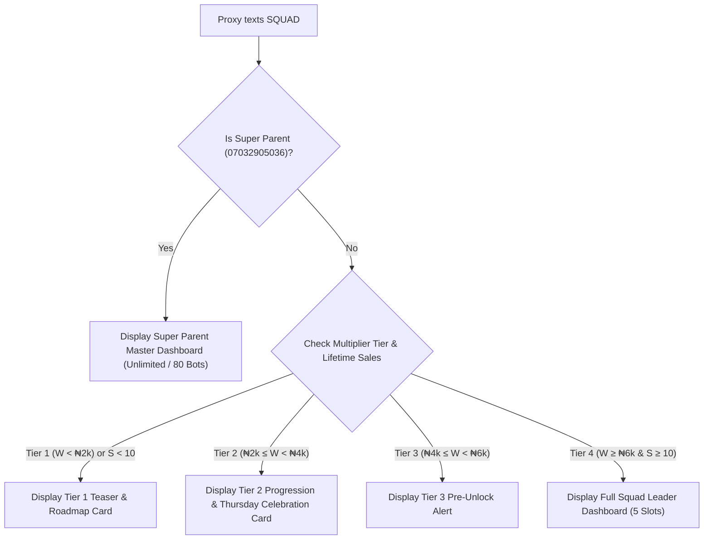
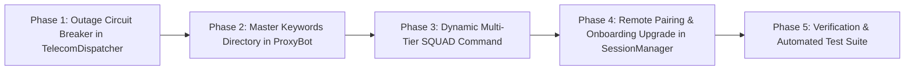

# 📋 Clarion Implementation Plan: Store Keywords Directory, Dynamic Squad Architecture & Telecom Outage Resilience

---

## Executive Overview

This implementation plan details the technical architecture, conversational copy, and step-by-step engineering tasks to deliver four interconnected features for the Clarion AI WhatsApp Data Franchise:

1. **Master Keywords & Tips Directory (`KEYWORDS`, `HELP`, `COMMANDS`, `TIPS`)**: A dedicated, Apple-style command reference and how-to guide accessible anytime by child and semi-parent proxies.
2. **Dynamic Multi-Tier `SQUAD` Command**: Allowing *any* proxy (regardless of their active multiplier tier) to text `SQUAD` and receive tailored, progressive disclosure messaging—ranging from an educational teaser and unlock roadmap (Tiers 1–3) to a live 5-partner manager dashboard (Tier 4).
3. **Telecom Outage & Service Degradation Health Circuit Breaker**: Proactive detection of gateway failures in [`TelecomDispatcher.js`](file:///c:/Users/m/Downloads/nysc/src/services/TelecomDispatcher.js), marking affected packages as `[Temporarily Paused]` in `DATA` and `DATA + PRICE` menus, and protecting customer funds with instant wallet storage and 1-click swaps.
4. **Child Proxy Onboarding for Super Parent `07032905036`**: The full onboarding handshake triggered by `SUGGEST [Phone] [Name]`, supporting both physical QR scanning and remote 8-digit pairing codes with automatic Firestore binding under Mustapha Lawal Gambo.

---

## 1. Feature Specifications

### 1.1 Master Keywords & Store Tips Directory (`KEYWORDS`, `HELP`, `COMMANDS`, `TIPS`)

#### Trigger Keywords
- `keywords`, `keyword`, `commands`, `command`, `help`, `store`, `tips`, `howto`, `menu` (when sent by the bot owner to their own bot).

#### Design Philosophy
- Sculpted, spacious "Apple Vibe" typography.
- Grouped into 4 functional domains: **Vending**, **Wallet & Earnings**, **Squad & Growth**, and **Tools & Support**.
- Contextual pro-tips explaining how the 24/7 AI works, how WhatsApp status updates generate passive sales, and how keeping wallet float boosts earning power.

#### Conversational Template (Sent to Proxy Owner)
```text
✦ Clarion Store OS · Command Directory
━━━━━━━━━━━━━━Welcome to your franchise command center. Your AI bot runs 24/7 in autonomous mode.

🛍️ VENDING & CATALOG
• DATA — Browse the live data package catalog
• DATA [budget] — Filter plans (e.g. DATA 1000 or DATA 2500)
• BUY [code] — Vend for yourself or gift someone at wholesale
• MTN / GLO / AIRTEL — Quick-filter plans by telecom network

💳 WALLET & EARNINGS
• BALANCE — View active wallet float, Multiplier status & yield
• FUND [amount] — Add float to upgrade Multiplier (e.g. FUND 2000)
• WITHDRAW — Cash out earnings to your bank (every Thursday)
• BANK [Account] [Bank] — Bind or update verified NUBAN account

👥 SQUAD & NETWORK
• SQUAD — View your 5-partner downline & unlock progress
• SUGGEST [Phone] [Name] — Onboard a new partner (Tier 4)
• STATS — Lifetime sales, total orders & revenue analytics

🔧 TOOLS & ASSISTANCE
• BACKUP CONTACTS — Export all customer leads as .vcf to phone
• STATUS — Check 24/7 WhatsApp AI bot connection health
• TIPS — View top pro-tips to increase daily customer orders

━━━━━━━━━━━━━━💡 Pro-Tip: When friends text DATA to this chat, Clarion automatically takes payment and delivers data in 3 seconds. You keep the profit without lifting a finger. ✦
```

---

### 1.2 Dynamic Multi-Tier `SQUAD` Command Architecture

#### The Problem
Previously, typing `squad` assumed the user was already a parent with active partners, displaying a confusing message and referencing outdated "Data Fuel". If a Tier 1–3 proxy typed `squad`, they were left in the dark about how to unlock the feature.

#### The Progressive Disclosure Model
Every proxy can now text `SQUAD` at any time. The bot dynamically evaluates:
1. Available Wallet Balance ($W$) $\rightarrow$ Multiplier Tier (1X, 2X, 3X, 4X).
2. Lifetime Completed Sales ($S$) from `user.metrics.totalOrders`.



---

#### Conversational Templates by Tier

##### Tier 1 Response ($W < ₦2,000$ or $S < 10$ Sales): The Teaser & Roadmap
```text
✦ Clarion Squad Network · Level 1
━━━━━━━━━━━━━━Build a passive sales downline with up to 5 child proxy bots.

How Squad Works:
You sponsor up to 5 partners. Clarion deploys an automated 24/7 AI bot on their WhatsApp lines. You earn a passive 30% override on every data bundle their bots sell—forever.

🔒 Unlocking Requirements:
1. Operational Milestone: 10 completed data sales
   Progress: [████░░░░░░] {sales}/10 Completed
2. Capital Floor: Tier 4 Liquidity (₦6,000 Wallet Float)
   Progress: [███░░░░░░░] ₦{balance} / ₦6,000

✨ Next Milestone:
Add ₦{neededForTier2} to reach Tier 2 (2X Power) and unlock Thursday personal bank cashouts!

👉 Reply FUND to add wallet float.
👉 Reply KEYWORDS to view all store commands.
```

##### Tier 2 Response ($₦2,000 \le W < ₦4,000$): The Progression & Cashout Milestone
```text
✦ Clarion Squad Network · Level 2
━━━━━━━━━━━━━━🎉 Thursday Cashouts: UNLOCKED ✅
Active Earning Power: Tier 2 (2X Multiplier)

You are halfway to becoming a Squad Leader!

🔒 Squad Unlock Roadmap:
1. Completed Sales: {sales}/10 orders {salesCheck}
2. Wallet Liquidity: ₦{balance} / ₦6,000 float
   ↳ Need ₦{neededForTier4} more to reach Tier 4 (4X Max Power)

✨ Squad Leadership Privilege:
At Tier 4, you unlock 5 Squad Partner slots. 5 bots selling 10 plans/day each generates ₦15,000+ monthly passive income directly to your wallet.

👉 Reply FUND {neededForTier4} to jump directly to Tier 4.
```

##### Tier 3 Response ($₦4,000 \le W < ₦6,000$): The Pre-Unlock Surge
```text
✦ Clarion Squad Network · Level 3
━━━━━━━━━━━━━━🔥 You are 1 step away from Squad Leadership!
Active Earning Power: Tier 3 (3X Multiplier)

Squad Unlock Status:
• Sales Milestone: {sales}/10 completed {salesCheck}
• Wallet Liquidity: [████████████░░] ₦{balance} / ₦6,000
• Gap to Unlock: Just ₦{neededForTier4} remaining!

Once you reach ₦6,000:
✦ 4X Maximum Multiplier unlocked on all customer sales.
✦ 4X Wholesale Discount on personal & gift data.
✦ 5 Squad Referral slots unlocked via SUGGEST.

👉 Reply FUND {neededForTier4} to activate Squad Leadership right now.
```

##### Tier 4 Response ($W \ge ₦6,000$ and $S \ge 10$ Sales): The Squad Leader Dashboard
```text
✦ Clarion Squad Leadership · Tier 4 (4X Active)
━━━━━━━━━━━━━━Welcome, Squad Leader. Your network is active.

👥 Your Squad Capacity: {activeCount} / 5 Partners Active
✦ Weekly Downline Yield: +₦{weeklyYield}

Partner Roster:
1. Aminu Bello (+2348021234567) · 🟢 Online · 14 Orders (₦18,200)
2. Blessing Okon (+2348149876543) · 🟢 Online · 9 Orders (₦11,400)
3. [Available Slot] ➔ Reply SUGGEST [Phone] [Name] to invite
4. [Available Slot] ➔ Reply SUGGEST [Phone] [Name] to invite
5. [Available Slot] ➔ Reply SUGGEST [Phone] [Name] to invite

━━━━━━━━━━━━━━👉 Reply SUGGEST [Phone] [Name] to bind a partner to an available slot.
_Both of you can link physically via QR or remotely via 8-digit pairing code._
```

---

### 1.3 When to Proactively Reveal Squad to Child Proxies

Rather than overwhelming the user on Day 1, Squad benefits are introduced across 3 natural milestones:

| Moment | Trigger | Communication Channel | Message Goal |
| :--- | :--- | :--- | :--- |
| **Moment 1: Onboarding Welcome Kit** | Upon initial QR/Code scan | WhatsApp Direct Welcome Message | Teaser: Mention `SQUAD` among key commands ("Unlock your 5-partner squad at Tier 4"). |
| **Moment 2: 10th Completed Sale Milestone** | Immediate upon 10th order confirmation | WhatsApp Event Ping | Celebration: "🏆 10 Sales Milestone reached! You've qualified for Squad Leadership. Add float to ₦6,000 to activate your 5 partner slots." |
| **Moment 3: Daily 8:00 PM Golden Hour Digest** | Every evening at 8:00 PM | Automated CRON Yield Report | Progress Pill: Show `👥 Squad: Tier X ({sales}/10 Sales | ₦{balance}/₦6k Float)`. |

---

### 1.4 Telecom Outage Circuit Breaker & Customer Guidance

#### Technical Circuit Breaker Architecture
Inside [`TelecomDispatcher.js`](file:///c:/Users/m/Downloads/nysc/src/services/TelecomDispatcher.js):
- **Health State Tracker**: Maps each telecom network (`mtn`, `glo`, `airtel`) and individual plan code (`M1GBS`, `M2GBS`, `A10GB`) to an in-memory health object:
  ```javascript
  {
    status: 'HEALTHY' | 'DEGRADED' | 'DOWN',
    failureCount: 0,
    lastFailureTime: null,
    cooldownUntil: null,
    reason: null
  }
  ```
- **Tripping Mechanism**:
  - If a plan fails on *both* Husmodata and Peyflex during live dispatch $\rightarrow$ increment `failureCount`.
  - At 2 consecutive failures within 10 minutes $\rightarrow$ trip to `DEGRADED` with a 15-minute cooldown.
  - While `DEGRADED`, background health checks probe status without risking customer money.
- **Menu Integration (`DATA` / `DATA [price]` / `MTN` / `GLO` / `AIRTEL`)**:
  - Packages flagged as `DEGRADED` render with a discreet badge: `• 2GB (7 Days) — ₦1,200 ➔ [Temporarily Paused] 🟡`
  - A friendly footnote advises: `💡 MTN 2GB is briefly undergoing telecom gateway optimization. Other packages deliver in 3 seconds!`
- **Direct Order Interception (`BUY [code]`)**:
  - If a customer replies `BUY M2GBS` while paused, the bot intercepts *before taking payment*:
    ```text
    🟡 TEMPORARY GATEWAY NOTICE ⚡
    ━━━━━━━━━━━━━━    The MTN 2GB package is currently undergoing brief telecom server maintenance.
    To protect your money, orders for this plan are temporarily paused.

    ✨ Instant Alternatives Delivering Right Now:
    1️⃣ MTN 1GB (7 Days) — ₦600 (Reply BUY M1GBS)
    2️⃣ MTN 3GB (7 Days) — ₦1,400 (Reply BUY M3GBS)
    3️⃣ Airtel 2GB (30 Days) — ₦1,500 (Reply BUY A2GB)
    ```

---

### 1.5 Child Proxy Onboarding Flow for Super Parent `07032905036`

#### Dual Pairing Support (Physical & Remote)
When Super Parent `07032905036` texts:
```text
SUGGEST 08021234567 Aminu Bello
```
Clarion executes:
1. Validates `07032905036` is Super Parent (or Tier 4 proxy with available squad slots).
2. Creates candidate document in `db.users.doc('2348021234567@s.whatsapp.net')`:
   - `parentId: '2347032905036@s.whatsapp.net'`
   - `state: 'AWAITING_PAIRING'`
   - `role: 'CHILD_PROXY'`
   - `multiplierTier: 'Tier 1 (1X)'`
3. Calls `sessionManager.requestPairingCodeForUser(candidate)` and `startQRPairingForUser(candidate)`:
   - Returns both a **High-Resolution QR Code Image** (for in-person scanning) AND an **8-Digit Pairing Code** (e.g. `K7M9-2P4X`) for remote onboarding via WhatsApp forward.
4. When Aminu Bello scans QR or inputs pairing code:
   - Session connects.
   - `SessionManager.js` sets `botMode: 'AUTONOMOUS'`, `terminalApproved: true`.
   - Dispatches **The Genesis Welcome Kit** directly to Aminu.
   - Sends a confirmation alert to Super Parent `07032905036`.

---

## 2. Implementation Phases



### Phase 1: Telecom Outage & Circuit Breaker Engine
- **Target File**: [`src/services/TelecomDispatcher.js`](file:///c:/Users/m/Downloads/nysc/src/services/TelecomDispatcher.js)
- **Modifications**:
  1. Add `planHealthMap` with `getPlanHealth(code)` and `recordPlanFailure(code, reason)` / `recordPlanSuccess(code)`.
  2. Implement 15-minute automatic cooldown timer.
  3. Export `getDegradedPlans()` and `isNetworkDegraded(network)`.
- **Target File**: [`src/bot/ProxyBot.js`](file:///c:/Users/m/Downloads/nysc/src/bot/ProxyBot.js)
- **Modifications**:
  1. Update `DATA` / `DATA [price]` menu generator to check `getPlanHealth()`.
  2. Display `[Temporarily Paused] 🟡` alongside affected plans.
  3. Intercept `BUY [code]` before invoice generation if plan is currently paused.

---

### Phase 2: Master Keywords Directory (`KEYWORDS` / `HELP` / `TIPS`)
- **Target File**: [`src/bot/ProxyBot.js`](file:///c:/Users/m/Downloads/nysc/src/bot/ProxyBot.js)
- **Modifications**:
  1. Add command regex matching `keywords`, `commands`, `help`, `tips`, `howto`, `store`.
  2. Implement formatted Apple Vibe response with categorized sections (Vending, Wallet, Squad, Tools).
  3. Tailor the menu slightly if caller is Super Parent `07032905036` (highlighting administrative privileges).

---

### Phase 3: Dynamic Multi-Tier `SQUAD` Command
- **Target File**: [`src/bot/ProxyBot.js`](file:///c:/Users/m/Downloads/nysc/src/bot/ProxyBot.js)
- **Modifications**:
  1. Refactor `cleanCommand === 'squad' || cleanCommand === 'myrefs' || cleanCommand === 'partners'`.
  2. Remove legacy references to "Data Fuel" and fixed "35% split".
  3. Fetch `user.metrics.totalOrders` and wallet balance.
  4. Render dynamically:
     - **Tier 1**: Educational teaser + progress bar to Tier 2 & Squad.
     - **Tier 2**: Progression update + celebration of Thursday cashouts.
     - **Tier 3**: Pre-unlock countdown to Tier 4 Squad Leadership.
     - **Tier 4 / Super Parent**: Full live roster of up to 5 partners with real-time sales stats and `SUGGEST` guide.
- **Target File**: [`src/jobs/walletYieldReportJob.js`](file:///c:/Users/m/Downloads/nysc/src/jobs/walletYieldReportJob.js)
- **Modifications**:
  1. Add Squad unlock pill to the daily 8:00 PM Golden Hour report.

---

### Phase 4: Super Parent Child Proxy Onboarding Upgrade
- **Target File**: [`src/bot/SessionManager.js`](file:///c:/Users/m/Downloads/nysc/src/bot/SessionManager.js)
- **Modifications**:
  1. Update `_sendActivationSuccessMessages()`: replace legacy "Data Fuel" welcome copy with **The Genesis Welcome Kit (Apple Vibe)**.
  2. Support generating both QR image and 8-digit pairing code simultaneously in `startQRPairingForUser()`.
  3. Hardcode sponsor attribution to `2347032905036@s.whatsapp.net` when suggested by Super Parent.

---

### Phase 5: Verification & Automated Test Suite
- **Target File**: `scratch/test_keywords_squad_and_outage.js`
- **Tests Included**:
  1. **Test 1**: Verify `KEYWORDS` / `HELP` command response formatting and command completeness.
  2. **Test 2**: Verify `SQUAD` dynamic responses across Tier 1, Tier 2, Tier 3, and Tier 4.
  3. **Test 3**: Circuit breaker trip and recovery simulation: confirm `DEGRADED` status renders in `DATA` menu and blocks `BUY`.
  4. **Test 4**: Super Parent `07032905036` squad suggestion and candidate document verification.
  5. **Test 5**: Syntax checks across all modified source files.

---

## 3. Recommendations & Edge Cases

### 3.1 Recommendations
1. **Never Show Raw Error Stacks to Customers**: If a telecom gateway fails, translate the technical error into reassuring customer language: *"Telecom exchange servers are briefly optimizing this bundle. Your funds are 100% secured in your wallet."*
2. **Encourage Float Retention Over Cashout**: Framed as a business choice: *"Your wallet balance isn't idle cash—it is active float earning you up to 4X on every customer order and unlocking 4X wholesale data for yourself."*
3. **Offer Remote Pairing as First-Class**: Many Corps Members or agents are in different LGAs or states. Providing the 8-digit WhatsApp pairing code alongside the QR code ensures 100% onboarding success without physical proximity.

### 3.2 Edge Cases & Mitigations

| Edge Case | Risk | Mitigation |
| :--- | :--- | :--- |
| **Proxy texts `SUGGEST` with insufficient sales or balance** | Proxy feels blocked without understanding why. | Send actionable Tier 4 roadmap: *"Squad partner slots unlock at Tier 4 (₦6,000 float + 10 sales). Reply FUND to level up."* |
| **Customer has funds in wallet from a failed order and texts `DATA`** | Customer might worry about double-charging. | Detect customer wallet balance at the top of the `DATA` menu: *"💰 You have ₦1,200 stored in your wallet. Reply BUY [code] to use it with 1 tap."* |
| **All 5 Squad slots are filled** | Proxy tries to recruit a 6th partner. | Display capacity notice: *"Your Squad is at full capacity (5/5). Coach your active partners to boost your passive 30% overrides!"* |
| **A degraded plan recovers early** | Plan remains paused longer than necessary. | The circuit breaker allows a single test dispatch or resets automatically after 15 minutes of quiet time. |

---

## 4. Next Step & Action Required

Please review this implementation plan. Once you give the approval to proceed, Phase 1 through Phase 5 will be executed cleanly, tested, and verified.

