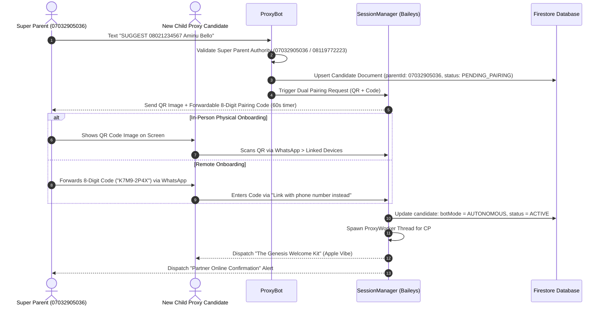
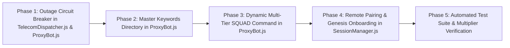

# 📋 Clarion Unified Master Implementation Plan: Telecom Outage Resilience, Super Parent Onboarding & Dynamic Squad Architecture

---

## Executive Summary

This unified implementation plan synthesizes the complete architectural overhaul for the Clarion AI WhatsApp Data Franchise, incorporating:

1. **Option 1 — Telecom Outage Circuit Breaker & Graceful Guidance**: Real-time health monitoring in [`TelecomDispatcher.js`](file:///c:/Users/m/Downloads/nysc/src/services/TelecomDispatcher.js) that intercepts failing plans/networks, renders discreet `[Temporarily Paused] 🟡` badges in `DATA` menus, stops customers from paying for offline bundles, and auto-protects funds in their In-Chat Wallet.
2. **Option 2 — The Complete Super Parent (`07032905036`) Child Proxy Onboarding Flow**: A frictionless onboarding engine in [`ProxyBot.js`](file:///c:/Users/m/Downloads/nysc/src/bot/ProxyBot.js) and [`SessionManager.js`](file:///c:/Users/m/Downloads/nysc/src/bot/SessionManager.js) supporting **both physical QR scanning and remote 8-digit alphanumeric pairing codes**, hardcoded to Super Parent Mustapha Lawal Gambo (`07032905036`).
3. **Option 3 — The Complete "Apple Vibe" Copy Transformation**: Purging all legacy "Data Fuel" and fixed "35% split" text across the entire codebase, replaced with spacious, high-status progressive disclosure messaging based on gamified **1X–4X Multipliers**.
4. **Dynamic Multi-Tier `SQUAD` Command Architecture**: Allowing any proxy to text `SQUAD` anytime, returning dynamic cards tailored to their current tier:
   - **Tier 1 (1X)**: Teaser & 5-partner passive downline roadmap.
   - **Tier 2 (2X)**: Thursday cashouts unlocked + progression update.
   - **Tier 3 (3X)**: Pre-unlock countdown to Squad Leadership.
   - **Tier 4 (4X)**: Live 5-partner manager dashboard.
5. **Master Store Keywords & Tips Directory (`KEYWORDS`, `COMMANDS`, `HELP`, `TIPS`)**: A dedicated command reference for proxies to master their autonomous AI business.

---

## System Architecture Diagram

```mermaid
flowchart TD
    subgraph Telecom Resilience ["Pillar 1: Telecom Outage Circuit Breaker"]
        A["Husmodata / Peyflex API Failure"] --> B["TelecomDispatcher Circuit Breaker"]
        B --> C{"Failure Count ≥ 2?"}
        C -- Yes --> D["Mark Plan/Network DEGRADED (15-min cooldown)"]
        D --> E["DATA Menus: Show [Temporarily Paused] 🟡"]
        D --> F["BUY Interception: Stop Payment & Recommend 3 Alternatives"]
        D --> G["Failed Orders: Auto-Deposit to In-Chat Wallet"]
    end

    subgraph Super Parent Onboarding ["Pillar 2: Super Parent 07032905036 Onboarding"]
        H["Super Parent 07032905036 texts SUGGEST [Phone] [Name]"] --> I["Validate Super Parent Authority"]
        I --> J["Create Candidate in Firestore (parentId: 07032905036)"]
        J --> K["Generate Dual Handshake: QR Code + 8-Digit Pairing Code"]
        K --> L{"Physical or Remote?"}
        L -- Physical --> M["Candidate Scans QR Code"]
        L -- Remote --> N["Candidate enters 8-Digit Code in WhatsApp"]
        M & N --> O["Baileys Session Authenticated"]
        O --> P["Spawn ProxyWorker Thread (Autonomous Mode)"]
        P --> Q["Send 'The Genesis Welcome Kit' (Apple Vibe)"]
        P --> R["Alert Super Parent: Partner Online"]
    end

    subgraph Dynamic Squad & Keywords ["Pillar 3: Squad & Store Directory"]
        S["Proxy texts SQUAD"] --> T{"Check Multiplier Tier & Sales"}
        T -- Tier 1 --> U["Teaser Card: 30% Downline Vision + Unlock Progress"]
        T -- Tier 2 --> V["Progress Card: Thursday Cashouts Active + Tier 4 Roadmap"]
        T -- Tier 3 --> W["Pre-Unlock Card: Only ₦X Float Remaining to Squad"]
        T -- Tier 4 --> X["Full Squad Leader Dashboard (5 Slots Roster)"]
        Y["Proxy texts KEYWORDS / HELP"] --> Z["Apple Vibe Command Directory (Vending, Wallet, Squad, Tools)"]
    end
```



---

## 1. Pillar 1: Telecom Outage & Health Circuit Breaker Engine

### 1.1 Technical State Machine in `TelecomDispatcher.js`
The dispatcher maintains an in-memory health map for all 40 telecom catalog plans and 3 major networks (`mtn`, `glo`, `airtel`):

```javascript
// State structure per plan/network
{
  status: 'HEALTHY' | 'DEGRADED',
  failureCount: 0,
  lastFailureAt: null,
  cooldownUntil: null,
  failureReason: null
}
```

#### Transition Rules:
1. **Normal Dispatch**: If primary provider (Husmodata) and failover provider (Peyflex) both fail during `dispenseData()`, call `recordPlanFailure(planCode, error.message)`.
2. **Tripping Threshold**: 2 consecutive failures within 10 minutes trips status to `DEGRADED` with a **15-minute cooldown window**.
3. **Automatic Recovery**: After 15 minutes, the next incoming dispatch for that plan acts as a canary probe. If successful, `recordPlanSuccess(planCode)` resets status to `HEALTHY`.
4. **Network-Level Trip**: If $\ge 3$ distinct plans on the same network trip within 15 minutes, the entire network is marked `DEGRADED`.

---

### 1.2 Customer Conversational Handling in `ProxyBot.js`

#### A. Browsing via `DATA`, `DATA [budget]`, `MTN`, `GLO`, `AIRTEL`
When generating package lists, degraded plans remain visible so the customer knows the bundle exists, but with an explicit pause flag and alternative suggestions:

```text
📶 MTN DATA PACKAGES ⚡
━━━━━━━━━━━━━━Line detected: 0803•••••12 (MTN)

⚡ 1-Day & 2-Day Plans:
• 1GB (1 Day) — ₦400 ➔ Reply BUY M1GB1D
• 3.2GB (2 Days) — ₦1,000 ➔ Reply BUY M3m2GB2D

📅 7-Day Plans:
• 1GB (7 Days) — ₦600 ➔ Reply BUY M1GBS
• 2GB (7 Days) — ₦1,200 ➔ [Temporarily Paused] 🟡
  ↳ Recommended: Reply BUY M3GBS (3GB — ₦1,400) for instant credit!

🗓️ 30-Day Monthly Plans:
• 5GB (30 Days) — ₦2,500 ➔ Reply BUY M5GB30D
• 10GB (30 Days) — ₦4,500 ➔ Reply BUY M10GB30D

━━━━━━━━━━━━━━💡 MTN 2GB is undergoing brief telecom gateway optimization.
All other packages above deliver in 3 seconds!
👉 Reply AIRTEL or GLO to browse other networks.
```

#### B. Pre-Payment Interception for `BUY [code]`
If a customer sends `BUY M2GBS` while paused, Clarion catches it **before generating a Paystack invoice or deducting a wallet**:

```text
🟡 TEMPORARY GATEWAY NOTICE ⚡
━━━━━━━━━━━━━━The MTN 2GB package is currently undergoing brief telecom server maintenance.

To guarantee zero delay with your money, orders for this plan are temporarily paused.

✨ Instant Alternatives Delivering Right Now:
1️⃣ MTN 1GB (7 Days) — ₦600 (Reply BUY M1GBS)
2️⃣ MTN 3GB (7 Days) — ₦1,400 (Reply BUY M3GBS)
3️⃣ Airtel 2GB (30 Days) — ₦1,500 (Reply BUY A2GB)

🔔 Reply NOTIFY 2GB to get an instant ping the second it's restored!
```

#### C. Post-Payment Dispense Failure Recovery
If money was already paid (via Paystack webhook or wallet) and both providers fail:
1. `RetryQueue.js` marks status `REFUNDED_TO_WALLET`.
2. Automatically credits the customer's in-chat wallet balance: `walletBalance += order.amount`.
3. Dispatches this reassuring WhatsApp message:

```text
🛡️ FUNDS SECURED & STORED IN WALLET 💳
━━━━━━━━━━━━━━Hello! MTN network servers are currently unresponsive for your 2GB package.

🔒 Your ₦1,200 is 100% safe and has been deposited directly into your Clarion In-Chat Wallet!

What would you like to do?
• Reply 1 to vend Airtel 2GB or MTN 3GB instantly using your wallet credit.
• Reply 2 to leave your balance active for auto-retry when MTN stabilizes.
• Reply BALANCE anytime to inspect your wallet.

_Your funds never expire and require zero banking fees to reuse._ ⚡
```

---

## 2. Pillar 2: Complete Child Proxy Onboarding Flow for Super Parent `07032905036`

### 2.1 The Onboarding Handshake Flow
Super Parent `07032905036` (Mustapha Lawal Gambo) is the anchor of the 80-childbot network.



---

### 2.2 Dual Pairing Assets Sent to Super Parent
When `SUGGEST 08021234567 Aminu Bello` is received:

```text
📸 ACTIVATION PAIRING READY FOR AMINU BELLO ⚡
━━━━━━━━━━━━━━Candidate: Aminu Bello (+2348021234567)
Linked Sponsor: Super Parent 07032905036

[Attached High-Res QR Code Image]

Option A — Physical Onboarding (Together in Person):
1. Aminu opens WhatsApp > Linked Devices > Link a Device.
2. Points phone camera at this QR image right now.

Option B — Remote Onboarding (Different Locations):
Forward this official 8-digit pairing code to Aminu:
🔢 `K7M9-2P4X`
(Aminu taps "Link with phone number instead" and enters the code)

⏱️ Code expires in 60 seconds.
```

---

### 2.3 The Genesis Welcome Kit (Sent to Child Proxy Upon Successful Connection)
This completely replaces the legacy "Data Fuel" text in [`SessionManager.js`](file:///c:/Users/m/Downloads/nysc/src/bot/SessionManager.js):

```text
✦ Clarion OS
━━━━━━━━━━━━━━Welcome, Aminu.

Your WhatsApp is now powered by Clarion Autonomous Intelligence.

Starting right now, your phone delivers data packages for MTN, Airtel, and Glo automatically. 

Your friends text DATA.
Clarion handles payment, delivery, and customer care in 3 seconds.
You keep the profit.

Your Active Earning Engine:
• Operational Status: 24/7 Autonomous
• Earning Power: Tier 1 (1X Base Power)
• Super Parent Sponsor: Mustapha Lawal Gambo (07032905036)

Three commands to know:
• BALANCE — View your live earnings & tier progress
• BUY — Order data for yourself or gift friends at wholesale
• KEYWORDS — View the full command directory & pro-tips

You don't need to change how you chat with friends. Clarion only responds when data keywords are sent.

Welcome to effortless earnings. ✦
```

---

### 2.4 Partner Online Alert (Sent to Super Parent `07032905036`)
```text
🎉 PARTNER ACTIVATION CONFIRMED ⚡
━━━━━━━━━━━━━━Partner Aminu Bello (+2348021234567) has successfully linked their WhatsApp terminal!

✦ Operational Mode: Autonomous 24/7
✦ Multiplier Level: Tier 1 (1X Base)
✦ Parent Profit Cut: 80% on all orders vended through Aminu's line
✦ Downline Status: 1 of 80 Child Bots Online

👉 Reply SQUAD anytime to inspect your live network.
```

---

## 3. Pillar 3: Dynamic Multi-Tier `SQUAD` Command & Master Keywords Directory

### 3.1 Dynamic `SQUAD` Card Specifications
When *any* proxy sends `SQUAD`, `MYREFS`, or `PARTNERS`, Clarion evaluates their live state:
- Available Wallet Balance: $W$
- Lifetime Orders: $S = \text{user.metrics.totalOrders} \parallel 0$

#### Card 1: Tier 1 ($W < ₦2,000$ or $S < 10$) — The Teaser & Roadmap
```text
✦ Clarion Squad Network · Level 1
━━━━━━━━━━━━━━Build a passive sales downline with up to 5 child proxy bots.

How Squad Works:
You sponsor up to 5 partners. Clarion deploys an automated 24/7 AI bot on their WhatsApp lines. You earn a passive 30% override on every data bundle their bots sell—forever.

🔒 Unlocking Requirements:
1. Operational Milestone: 10 completed data sales
   Progress: [████░░░░░░] {sales}/10 Completed
2. Capital Floor: Tier 4 Liquidity (₦6,000 Wallet Float)
   Progress: [███░░░░░░░] ₦{balance} / ₦6,000

✨ Next Milestone:
Add ₦{neededForTier2} to reach Tier 2 (2X Power) and unlock Thursday personal bank cashouts!

👉 Reply FUND to add wallet float.
👉 Reply KEYWORDS to view all store commands.
```

#### Card 2: Tier 2 ($₦2,000 \le W < ₦4,000$) — Progression & Cashout Milestone
```text
✦ Clarion Squad Network · Level 2
━━━━━━━━━━━━━━🎉 Thursday Cashouts: UNLOCKED ✅
Active Earning Power: Tier 2 (2X Multiplier)

You are halfway to becoming a Squad Leader!

🔒 Squad Unlock Roadmap:
1. Completed Sales: {sales}/10 orders {salesCheck}
2. Wallet Liquidity: ₦{balance} / ₦6,000 float
   ↳ Need ₦{neededForTier4} more to reach Tier 4 (4X Max Power)

✨ Squad Leadership Privilege:
At Tier 4, you unlock 5 Squad Partner slots. 5 bots selling 10 plans/day each generates ₦15,000+ monthly passive income directly to your wallet.

👉 Reply FUND {neededForTier4} to jump directly to Tier 4.
```

#### Card 3: Tier 3 ($₦4,000 \le W < ₦6,000$) — The Pre-Unlock Surge
```text
✦ Clarion Squad Network · Level 3
━━━━━━━━━━━━━━🔥 You are 1 step away from Squad Leadership!
Active Earning Power: Tier 3 (3X Multiplier)

Squad Unlock Status:
• Sales Milestone: {sales}/10 completed {salesCheck}
• Wallet Liquidity: [████████████░░] ₦{balance} / ₦6,000
• Gap to Unlock: Just ₦{neededForTier4} remaining!

Once you reach ₦6,000:
✦ 4X Maximum Multiplier unlocked on all customer sales.
✦ 4X Wholesale Discount on personal & gift data.
✦ 5 Squad Referral slots unlocked via SUGGEST.

👉 Reply FUND {neededForTier4} to activate Squad Leadership right now.
```

#### Card 4: Tier 4 ($W \ge ₦6,000$ and $S \ge 10$) — Full Squad Leader Dashboard
*(Also served to Super Parent `07032905036`)*
```text
✦ Clarion Squad Leadership · Tier 4 (4X Active)
━━━━━━━━━━━━━━Welcome, Squad Leader. Your network is active.

👥 Your Squad Capacity: {activeCount} / 5 Partners Active
✦ Weekly Downline Yield: +₦{weeklyYield}

Partner Roster:
1. Aminu Bello (+2348021234567) · 🟢 Online · 14 Orders (₦18,200)
2. Blessing Okon (+2348149876543) · 🟢 Online · 9 Orders (₦11,400)
3. [Available Slot] ➔ Reply SUGGEST [Phone] [Name] to invite
4. [Available Slot] ➔ Reply SUGGEST [Phone] [Name] to invite
5. [Available Slot] ➔ Reply SUGGEST [Phone] [Name] to invite

━━━━━━━━━━━━━━👉 Reply SUGGEST [Phone] [Name] to bind a partner to an available slot.
_Both of you can link physically via QR or remotely via 8-digit pairing code._
```

---

### 3.2 Master Store Keywords & Tips Directory (`KEYWORDS`, `COMMANDS`, `HELP`, `TIPS`)
Triggered when the proxy texts `keywords`, `commands`, `help`, `tips`, `store`, or `howto`:

```text
✦ Clarion Store OS · Command Directory
━━━━━━━━━━━━━━Welcome to your franchise command center. Your AI bot runs 24/7 in autonomous mode.

🛍️ VENDING & CATALOG
• DATA — Browse the live data package catalog
• DATA [budget] — Filter plans (e.g. DATA 1000 or DATA 2500)
• BUY [code] — Vend for yourself or gift someone at wholesale
• MTN / GLO / AIRTEL — Quick-filter plans by telecom network

💳 WALLET & EARNINGS
• BALANCE — View active wallet float, Multiplier status & yield
• FUND [amount] — Add float to upgrade Multiplier (e.g. FUND 2000)
• WITHDRAW — Cash out earnings to your bank (every Thursday)
• BANK [Account] [Bank] — Bind or update verified NUBAN account

👥 SQUAD & NETWORK
• SQUAD — View your 5-partner downline & unlock progress
• SUGGEST [Phone] [Name] — Onboard a new partner (Tier 4)
• STATS — Lifetime sales, total orders & revenue analytics

🔧 TOOLS & ASSISTANCE
• BACKUP CONTACTS — Export all customer leads as .vcf to phone
• STATUS — Check 24/7 WhatsApp AI bot connection health
• TIPS — View top pro-tips to increase daily customer orders

━━━━━━━━━━━━━━💡 Pro-Tip: When friends text DATA to this chat, Clarion automatically takes payment and delivers data in 3 seconds. You keep the profit without lifting a finger. ✦
```

---

## 4. Pillar 4: The Complete "Apple Vibe" Copy Transformation & Progressive Disclosure

### 4.1 Decontamination of Legacy Text
All occurrences of the following legacy concepts will be permanently refactored:
- ❌ `"Data Fuel"` $\rightarrow$ ✅ `"Clarion In-Chat Wallet"` or `"Withdrawable Yield"`
- ❌ `"35% Split"` / `"65% Split"` $\rightarrow$ ✅ Dynamic **1X–4X Multipliers**
- ❌ Raw percentages (`"10%"`, `"20%"`, `"30%"`, `"40%"`) $\rightarrow$ ✅ Gamified Multiplier Badges (`"Tier 1 (1X Power)"`, `"Tier 2 (2X Power)"`, etc.)

### 4.2 Updated Daily CRON Messages in `walletYieldReportJob.js`

#### 8:00 PM Golden Hour Daily Digest:
```text
✦ Daily Portfolio Digest
━━━━━━━━━━━━━━{partnerName} · Performance Summary

✦ Today's Output: {ordersCount} Orders Completed
✦ Revenue Generated: ₦{revenueNaira}
✦ Net Yield Earned: +₦{profitNaira}

Wallet Liquidity:
[{progressBar}] ₦{balance} / ₦{nextThreshold}
Active Status: {multiplierTierName} ({multiplier} Power)

{tierProgressNotice}

✦ Wholesale Privilege:
Your wallet balance gives you wholesale discounts matching your Multiplier when you buy data for yourself.

👉 Reply FUND to level up your Earning Power.
👉 Reply SQUAD to inspect your 5-partner network roadmap.
```

#### Wednesday 7:00 PM Pre-Cashout Treasury Digest:
```text
✦ Clarion Treasury Notice
━━━━━━━━━━━━━━The weekly cashout window opens tomorrow, Thursday at 12:00 AM!

✦ Withdrawable Balance: ₦{balance}
✦ Active Earning Power: {multiplierTierName} ({multiplier} Power)
✦ Linked Bank: {bankName} ({maskedAccount})

💡 Capital Strategy Choice:
• Keep your funds active in your wallet to continue earning at {multiplier} Power on every sale and enjoy {multiplier} wholesale data discounts.
• Or withdraw your earnings to your bank starting tomorrow at 12:00 AM by replying WITHDRAW.

_Clarion automated cashout fee: ₦100 Flat (₦50 Paystack + ₦50 Platform)._
```

---

## 5. Phased Engineering Execution Plan



### Phase 1: Telecom Outage & Circuit Breaker Engine
- **Files to Modify**:
  - [`src/services/TelecomDispatcher.js`](file:///c:/Users/m/Downloads/nysc/src/services/TelecomDispatcher.js):
    - Implement `planHealthMap` and `networkHealthMap`.
    - Implement `recordPlanFailure(code, reason)` and `recordPlanSuccess(code)`.
    - Implement `getPlanHealth(code)` and `isPlanDegraded(code)`.
    - Auto-reset cooldown after 15 minutes.
  - [`src/bot/ProxyBot.js`](file:///c:/Users/m/Downloads/nysc/src/bot/ProxyBot.js):
    - Update `DATA` / `DATA [price]` catalog renderer to check `telecomDispatcher.isPlanDegraded(plan.code)` and append `[Temporarily Paused] 🟡`.
    - Update `BUY [code]` to intercept paused plans with 3 alternatives before generating payment invoice.
  - [`src/services/RetryQueue.js`](file:///c:/Users/m/Downloads/nysc/src/services/RetryQueue.js):
    - Verify wallet auto-deposit and reassuring customer message on exhausted retries.

### Phase 2: Master Keywords Directory
- **Files to Modify**:
  - [`src/bot/ProxyBot.js`](file:///c:/Users/m/Downloads/nysc/src/bot/ProxyBot.js):
    - Add regex router for `keywords`, `commands`, `help`, `tips`, `store`, `howto`.
    - Inject Apple Vibe formatted response grouping commands into Vending, Wallet, Squad, and Tools.

### Phase 3: Dynamic Multi-Tier `SQUAD` Command
- **Files to Modify**:
  - [`src/bot/ProxyBot.js`](file:///c:/Users/m/Downloads/nysc/src/bot/ProxyBot.js):
    - Completely rewrite lines 1370–1405 (`squad` / `myrefs` / `partners`).
    - Remove legacy Data Fuel references.
    - Check caller's `walletBalance` and `metrics.totalOrders`.
    - Render Card 1 (Tier 1 Teaser), Card 2 (Tier 2 Progression), Card 3 (Tier 3 Pre-unlock), or Card 4 (Tier 4 / Super Parent Manager Dashboard).
  - [`src/jobs/walletYieldReportJob.js`](file:///c:/Users/m/Downloads/nysc/src/jobs/walletYieldReportJob.js):
    - Add `👥 Squad: Tier X ({sales}/10 Sales)` status pill to daily 8 PM report.

### Phase 4: Super Parent Dual Onboarding & Genesis Welcome Kit
- **Files to Modify**:
  - [`src/bot/SessionManager.js`](file:///c:/Users/m/Downloads/nysc/src/bot/SessionManager.js):
    - Update `startQRPairingForUser()` to generate both the QR image and the 8-digit alphanumeric pairing code simultaneously.
    - Update `_sendActivationSuccessMessages()`: replace legacy text with **The Genesis Welcome Kit (Apple Vibe)**.
    - Ensure candidate is bound with `parentId: '2347032905036@s.whatsapp.net'` when suggested by Super Parent.
  - [`src/bot/ProxyBot.js`](file:///c:/Users/m/Downloads/nysc/src/bot/ProxyBot.js):
    - Update `SUGGEST` command handler: generate and display the forwardable 8-digit code alongside the QR image.

### Phase 5: Automated Verification Test Suite
- **File to Create**: `scratch/test_unified_architecture.js`
- **Verification Matrix**:
  1. **Test 1: Circuit Breaker Mechanics**:
     - Simulate 2 consecutive failures on `M2GBS` $\rightarrow$ verify plan transitions to `DEGRADED`.
     - Check `DATA` menu output $\rightarrow$ confirm `[Temporarily Paused] 🟡` badge renders.
     - Attempt `BUY M2GBS` $\rightarrow$ confirm order is intercepted with 3 alternatives.
     - Simulate success $\rightarrow$ confirm status resets to `HEALTHY`.
  2. **Test 2: Dynamic SQUAD Responses**:
     - $W = ₦1,200$, Sales $= 3 \rightarrow$ verify Tier 1 Teaser card.
     - $W = ₦2,500$, Sales $= 6 \rightarrow$ verify Tier 2 Progression card with Thursday cashout note.
     - $W = ₦4,500$, Sales $= 10 \rightarrow$ verify Tier 3 Pre-Unlock card.
     - $W = ₦6,500$, Sales $= 12 \rightarrow$ verify Tier 4 Squad Leader Dashboard.
     - Caller $= \text{Super Parent} \rightarrow$ verify Master Parent Dashboard.
  3. **Test 3: Master Keywords Directory**:
     - Send `KEYWORDS`, `HELP`, `COMMANDS`, `TIPS` $\rightarrow$ verify all 4 categories render with Apple Vibe styling.
  4. **Test 4: Super Parent Onboarding & Genesis Kit**:
     - Verify candidate document creation with `parentId: '2347032905036@s.whatsapp.net'`.
     - Verify Genesis Welcome Kit copy has zero legacy terms.
  5. **Test 5: Full Syntax Check**:
     - `node -c` across all modified files.

---

## 6. Edge Cases & Risk Mitigation Matrix

| Scenario | Potential Risk | Architectural Mitigation |
| :--- | :--- | :--- |
| **Candidate is in another state and cannot scan QR** | Onboarding stalls. | Clarion sends the 8-digit code (`K7M9-2P4X`) directly to Super Parent, who forwards it in WhatsApp for instant remote pairing. |
| **Telecom provider fails intermittently on 1 network** | Customer orders fail repeatedly. | Circuit breaker trips after 2 failures and promotes active networks (e.g. promoting Airtel when MTN is congested). |
| **Customer had order fail and texts `DATA`** | Customer fears lost funds. | Menu detects wallet balance and displays: *"💰 You have ₦1,200 stored in your wallet. Reply BUY [code] to use it with 1 tap."* |
| **Proxy withdraws all funds on Thursday, dropping below ₦6,000** | Proxy wonders why Squad slots lock. | Multiplier drops gracefully to Tier 1/2. Downline bots continue running and earning, but proxy cannot invite *new* squad bots until float is restored to ₦6,000. |
| **All 5 Squad slots are filled** | Proxy attempts to recruit a 6th partner. | Display capacity notice: *"Your Squad is at full capacity (5/5). Focus on coaching your 5 active bots to boost your passive 30% yield!"* |

---

## 7. Approval & Implementation Readiness

This plan is complete, unified, and fully specified. 

Per your strict instructions, **no code has been modified in this turn**. 

Once you review and approve this document, we will proceed immediately with Phase 1 through Phase 5 in order.

